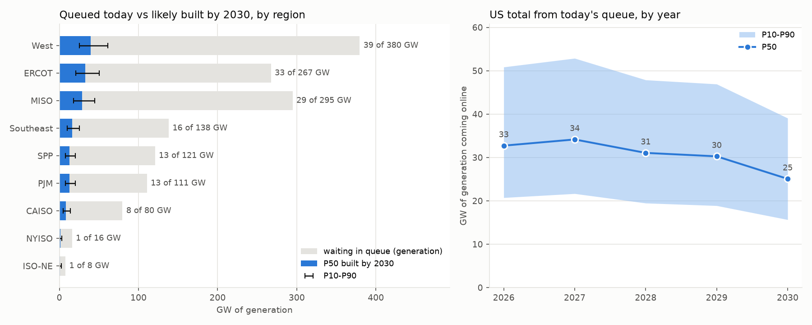

# Grid Queue Forecaster

Of the US power projects queued today, how much will realistically get built,
where, and when — with calibrated uncertainty.

**Finding:** of **1,415 GW** of generation waiting in US interconnection queues at
the end of 2025, about **153 GW is likely online by 2030 (P10–P90: 100–235 GW)** —
roughly 11% of the queue.

**Status:** Days 1–3 complete (clean → curves → backtest → outlook). Day 4: README
polish and public repo.

## Data
Berkeley Lab, *Queued Up: 2026 Edition* (project-level file, snapshot end-2025).
Not committed. Download to `data/raw/`:
~~~
curl -L -A "Mozilla/5.0" \
  "https://eta-publications.lbl.gov/sites/default/files/2026-05/lbnl_ix_queue_data_file_thru2025.xlsx" \
  -o data/raw/lbnl_ix_queue_data_file_thru2025.xlsx
~~~

## Run
~~~
uv sync
uv run python -m src.clean      # Stage 1: clean + define outcomes -> data/clean/projects.csv
uv run python -m src.validate   # exit check: counts vs the LBNL report
uv run python -m src.survival   # Stage 2: curves -> figures/curves_*.png, outputs/survival_summary.csv
uv run python -m src.backtest   # Stage 3: backtest + recalibration -> figures/backtest.png
uv run python -m src.simulate   # Stage 4: Monte Carlo -> figures/outlook.png, outputs/outlook.csv
uv run pytest                   # tests
~~~

## Pipeline
1. **Clean** (`src/clean.py`) — map every project to built / withdrawn / waiting with dates. ✅
2. **Survival** (`src/survival.py`) — Aalen-Johansen competing-risks curves by tech × region × size. ✅
3. **Backtest** (`src/backtest.py`) — fit as of 2019, score 2020–2025; recalibrate; measure aggregate error at 8 historical cutoffs. ✅ (project-level target only partly met — see `docs/DECISIONS.md`)
4. **Outlook** (`src/simulate.py`) — 10,000-run Monte Carlo, P10/P50/P90 GW by region and year, 2026–2030. ✅

## How much to trust it
The backtest criterion was restated after the original per-bin calibration target
failed (details in `docs/DECISIONS.md`, D14). Rebuilt at 10 past dates using only
what was known then, the P10–P90 range caught the actual build **6 times in 10**
(a plain Monte Carlo with one average rate: 2 in 10). Both miss in the same
direction in the same years — the whole queue's success rate drifts with policy
and prices, which no model trained on the past can foresee.

See `docs/DECISIONS.md` for every modelling choice and `docs/DATA_DICTIONARY.md`
for the cleaned schema.
