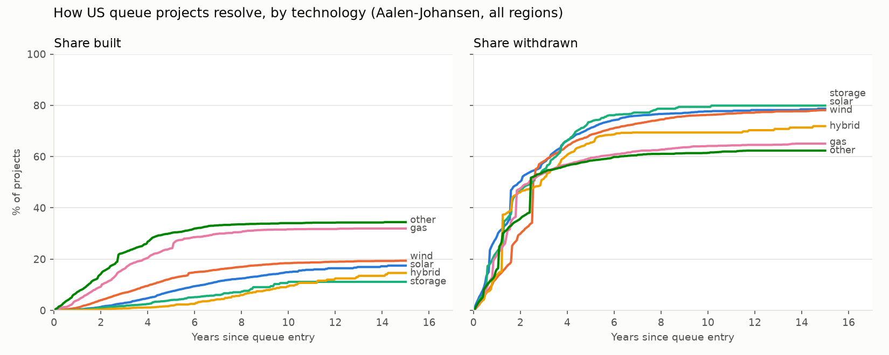
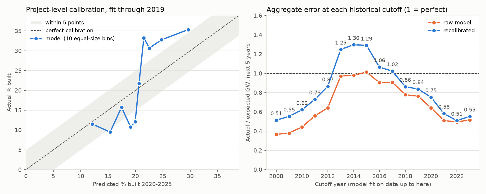

# Grid Queue Forecaster

Most power projects in US interconnection queues never get built, so the headline
queue total badly overstates future supply — a gap that matters now that AI data
centres need the power. This project asks: **of the projects queued today, how
much will realistically get built, where, and when?**

## Finding

Of **1,415 GW** of generation waiting in US interconnection queues at the end of
2025, about **153 GW is likely to be online by 2030 (range 100–235 GW)** —
roughly **11% of the queue**, or ~31 GW a year, close to the ~29 GW a year queued
projects actually delivered in 2021–25.

| Region | Likely built by 2030 (P50, GW) | Range (P10–P90) | Queued today (GW) |
|---|---|---|---|
| West | 39 | 25–61 | 380 |
| ERCOT | 33 | 21–51 | 267 |
| MISO | 29 | 18–45 | 295 |
| Southeast | 16 | 10–25 | 138 |
| SPP | 13 | 8–20 | 121 |
| PJM | 13 | 8–20 | 111 |
| CAISO | 8 | 5–14 | 80 |
| NYISO | 1 | 0–3 | 16 |
| ISO-NE | 1 | 0–3 | 8 |
| **US** | **153** | **100–235** | **1,415** |

Storage is counted separately so batteries aren't counted as supply: 57 GW
(37–88) of 578 GW queued. By year: `outputs/outlook.csv`.

## Three things the data shows

1. **About 18% of queued projects get built within 10 years; 75% withdraw.** The
   naive built ÷ total ratio says 12%, because it counts still-waiting projects
   as failures.
2. **What dominates the queue is least likely to be built.** Within 10 years:
   solar 15%, storage 11%, solar+storage hybrids 9% — vs gas 32%.
3. **ERCOT (Texas) builds at 2–3× other regions' rates** — e.g. solar 27% vs 5%
   in MISO.

## How much to trust it

- **Backtest as a gate.** Before forecasting, the model was fit on data through
  2019 and scored on 2020–2025. It **failed**: it overpredicted build-out by 40%,
  because build rates have been falling (22% of projects queued in 2000–04 were
  built within 5 years; 8% of those queued in 2018–20). Size effects and
  recalibration cut that error to 12%.
- **Range check.** The whole method was rebuilt at 10 past dates using only what
  was known at each. Its range caught what actually got built **6 times in 10** —
  short of the 8 in 10 an 80% range should hit, but far better than a plain Monte
  Carlo with one average build rate (**2 in 10**, because its ranges are falsely
  narrow).
- **The criterion changed after the first result.** The original target — every
  calibration bin within 5 points — was not met, and was restated to test totals,
  which is what the forecast reports. Both are documented in
  [`docs/DECISIONS.md`](docs/DECISIONS.md) (D6, D14).
- **What no model here can see:** the whole queue's success rate shifts with
  policy, interest rates and rule changes (e.g. FERC Order 2023). Both this model
  and the plain one miss in the same direction in the same years. The forecast
  assumes the last few years' conditions continue; if build rates recovered to
  their long-run average, the central estimate would be ~221 GW.

## What's new here — and what isn't

Berkeley Lab's *Queued Up* report already publishes aggregate completion rates;
this project builds on its data. What it adds: project-level odds that account
for how long each project has already waited, a backtest of those odds against
outcomes the model couldn't see, and capacity ranges by region and year.

## Method

1. **Clean** ([`src/clean.py`](src/clean.py)) — map 37,527 projects to built /
   withdrawn / still waiting, with dates. Counts match Berkeley Lab's published
   table in 26 of 27 region × status cells (the ERCOT gap is documented).
2. **Curves** ([`src/survival.py`](src/survival.py)) — Aalen-Johansen
   competing-risks curves (share built and share withdrawn by years in queue) by
   technology × region × size. Withdrawal is a competing outcome, not censoring:
   a withdrawn project can never be built.
3. **Backtest** ([`src/backtest.py`](src/backtest.py)) — the 2019 backtest,
   Platt recalibration, the model's error at 16 past dates, and the range check.
4. **Outlook** ([`src/simulate.py`](src/simulate.py)) — 10,000 simulation runs.
   Each run draws one shared "how wrong is the model this time" factor from its
   track record, then whether and when each waiting project is built.

Every modelling choice and its reason: [`docs/DECISIONS.md`](docs/DECISIONS.md).
Cleaned schema: [`docs/DATA_DICTIONARY.md`](docs/DATA_DICTIONARY.md).

**Limitations:** project-level odds are weak (the model ranks projects only
modestly better than chance — the file lacks study phase over time, permits and
upgrade costs); about a third of withdrawal dates are imputed (timing only —
results move under 1 point); 2025 completions may be under-reported in the
snapshot. **Next:** join Berkeley Lab's yearly editions to get each project's
study phase over time — the most promising route to better project-level odds.

## Run it

Data: Berkeley Lab, *Queued Up: 2026 Edition*, project-level file (snapshot
end-2025). The raw file isn't committed; download it to `data/raw/`:

~~~
curl -L -A "Mozilla/5.0" \
  "https://eta-publications.lbl.gov/sites/default/files/2026-05/lbnl_ix_queue_data_file_thru2025.xlsx" \
  -o data/raw/lbnl_ix_queue_data_file_thru2025.xlsx

uv sync
uv run python -m src.clean      # Stage 1 -> data/clean/projects.csv
uv run python -m src.validate   # counts vs the Berkeley Lab report
uv run python -m src.survival   # Stage 2 -> figures/curves_*.png
uv run python -m src.backtest   # Stage 3 -> figures/backtest.png, outputs/range_check.csv
uv run python -m src.simulate   # Stage 4 -> figures/outlook.png, outputs/outlook.csv
uv run pytest                   # 33 tests (the raw-data tests skip if the file is absent)
~~~

## How this was built

Built in four days from a written plan with success criteria, a decision log and
daily exit checks. Kevin Chen scoped the project, made the modelling decisions
and validated the results; the code was written with Claude Code (an AI coding
agent).
